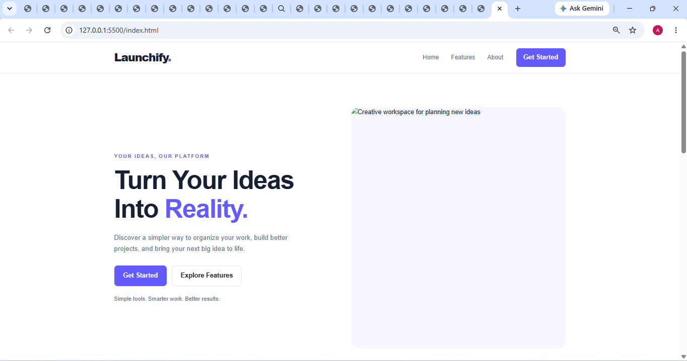
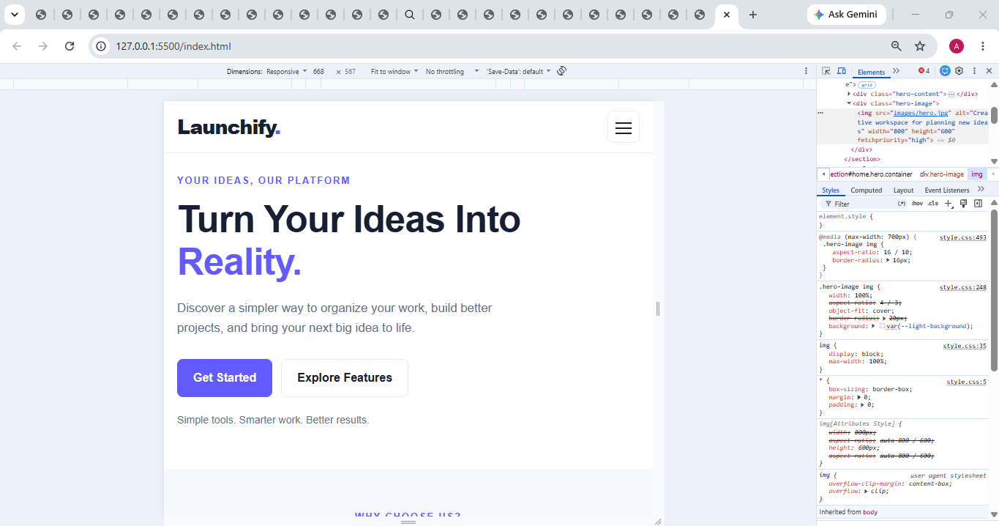
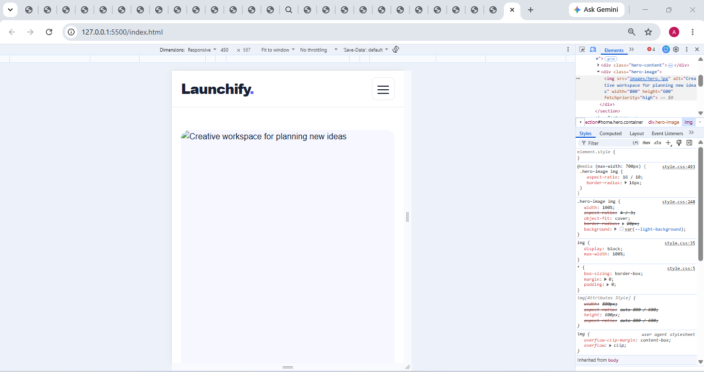

# Assignment 9.5 — Responsive Landing Page: Finish & Review

Aim: To complete and review the landing page created in Assignment 9.4, making it responsive, functional, visually consistent, and ready to include in a web development portfolio.

## Expected outcome: 
A complete landing page with responsive layouts, working navigation, scalable typography, correctly sized images, consistent spacing, and a mobile menu. After testing the page and pushing the final changes, it will be ready for assignment submission and potential inclusion in your portfolio.


## 3. Desktop screenshot.


## 4. Tablet screenshot.


## 5. Mobile screenshot.



## 1. Pushing the final changes to GitHub
```
git add .
git commit -m "Complete responsive landing page review"
git push
```

```
git push -u origin main
```

## final repository :

`https://github.com/Tanyaradzwa06/ASSIGNMENT9.5`


